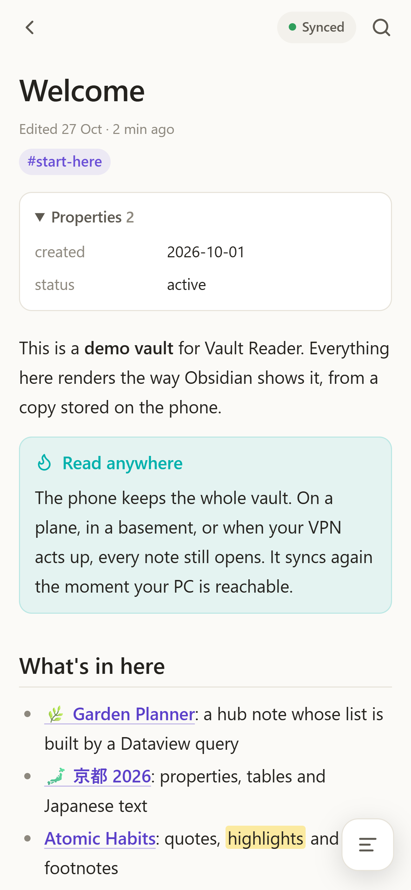
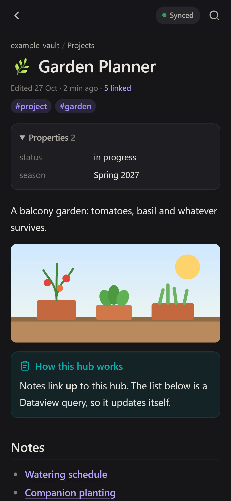
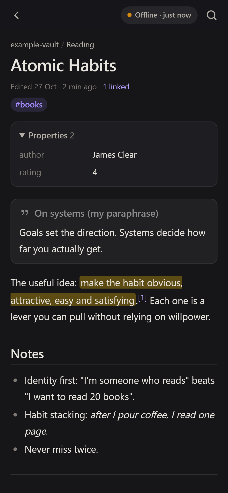

<div align="center">


# Vault Reader

**Your Obsidian vault in your pocket. Read-only, offline-first, served from your own PC.**

[Landing page](https://wmcmo.github.io/vault-reader/) · [Quick start](#quick-start) · [What renders](#what-renders)

&nbsp;
&nbsp;


</div>

---

Vault Reader is a tiny Node server that runs on the computer where your vault lives, plus a phone app (a PWA) that keeps a **full copy of the vault on the phone**. It renders notes the way Obsidian does: wikilinks, embeds, callouts, properties, Dataview lists. It works with no connection at all and syncs whenever your PC is reachable.

There is no sync service and no cloud. The PC renders, [Tailscale](https://tailscale.com) carries it to your phone over HTTPS, and nothing is ever written back to your vault.

## Why not just use Obsidian mobile?

Obsidian mobile is great. Vault Reader is for a narrower job:

| | Vault Reader | Obsidian mobile + sync |
|---|---|---|
| Needs a sync service | No, reads straight from your PC | Obsidian Sync, Syncthing, iCloud… |
| Can edit notes | No (by design) | Yes |
| Sync conflicts with desktop edits | Impossible | Possible |
| What reaches the phone | Only notes and images you allow | Everything you don't exclude |
| Works offline | Yes | Yes |

If you want to *read* your notes everywhere and keep writing on the desktop, this is for you.

## Features

- **Offline-first.** The whole vault is stored on the phone (IndexedDB + Cache Storage). Every note opens with no signal.
- **Smart, resumable sync.** The phone downloads only notes whose rendered output changed, in small batches, each saved as it arrives. Every request times out, so a flaky network never blocks reading.
- **Obsidian-accurate rendering**, done on the PC, so links resolve exactly like Obsidian's (shortest path, same folder first).
- **Dataview without Dataview.** Common `LIST` / `TABLE` queries are evaluated on the server.
- **Search** across titles, aliases, text and `#tags`, with CJK-friendly normalisation.
- **Backlinks**, a contents sheet for long notes, breadcrumbs, recent notes.
- **Light / dark / auto** themes and four text sizes.
- **Private by default.** Binds to `127.0.0.1`; only your tailnet can reach it. Exclude folders such as `_private`; dotfiles, `.env` and `node_modules` are never served.

## How it works

```
 ┌──────────── your PC ────────────┐            ┌──────────── phone ────────────┐
 │ Obsidian vault (Markdown files) │            │  PWA                           │
 │        │ scan + render          │  tailnet   │   ├─ IndexedDB: rendered notes │
 │ Node server  127.0.0.1:4610 ────┼── HTTPS ──▶│   ├─ Cache: images, PDFs      │
 │        ▲ tailscale serve :10443 │            │   └─ reads offline, syncs when │
 └─────────────────────────────────┘            │      the PC is reachable       │
                                                └────────────────────────────────┘
```

1. The server scans the vault, resolves links, renders every note to sanitised HTML and hashes it.
2. The phone fetches a manifest of hashes and downloads only what changed.
3. Everything is stored locally, so reading never waits on the network.

## Quick start

**You need:** Node.js 20+, an Obsidian vault on an always-on computer, and [Tailscale](https://tailscale.com/download) on that computer and your phone, with [MagicDNS and HTTPS certificates](https://tailscale.com/kb/1153/enabling-https) enabled for your tailnet.

```bash
git clone https://github.com/wmCmo/vault-reader.git
cd vault-reader
npm install
```

**Try it with the demo vault** (no config needed), then open http://localhost:4620:

```bash
npm run demo
```

**Point it at your vault.** Copy `config.example.json` to `config.json` and set `vault`:

```json
{
  "vault": "C:/Users/you/Documents/MyVault",
  "exclude": ["_private"],
  "port": 4610,
  "tailscaleHttpsPort": 10443,
  "lang": "en",
  "appName": "Vault"
}
```

**Start it.**

On Windows (runs hidden, skips if already running, sets up `tailscale serve`):

```powershell
.\start-vault-reader.ps1
```

On macOS / Linux:

```bash
npm start &
tailscale serve --bg --https=10443 http://127.0.0.1:4610
```

**Install it on your phone.** Open `https://<your-pc>.<tailnet>.ts.net:10443/` with Tailscale on, then use *Install app* (Chrome) or the install icon / *Add page to → Home screen* (Samsung Internet). The first launch downloads the vault; after that it opens offline.

## Configuration

| Key | Default | Meaning |
|---|---|---|
| `vault` | – | Path to the vault folder (absolute, or relative to this repo) |
| `exclude` | `[]` | Top-level folders never served, e.g. `["_private"]` |
| `port` | `4610` | Local port, bound to `127.0.0.1` only |
| `tailscaleHttpsPort` | `10443` | HTTPS port on your tailnet (used by the Windows scripts) |
| `lang` | `en` | Page language: picks CJK glyph variants and sort order (`ja`, `zh`, `ko`…) |
| `appName` | `Vault` | Name shown on the home screen |

Line breaks follow your vault's own *Strict line breaks* setting (`.obsidian/app.json`).

## What renders

| Obsidian feature | Support |
|---|---|
| Wikilinks: `[[note]]`, `[[note\|alias]]`, `[[note#heading]]`, `[[note#^block]]` | ✅ resolves like Obsidian; unresolved links are dimmed |
| Embeds: `![[note]]`, `![[note#section]]`, `![[image.png\|300]]`, PDFs, audio, video | ✅ notes embed up to two levels deep |
| Callouts, including foldable `[!tip]-` / `[!tip]+` and all built-in types | ✅ |
| Properties (frontmatter), including links and lists | ✅ |
| Tags (inline and frontmatter) | ✅ tap to search |
| Tasks, highlights `==x==`, comments `%%x%%`, footnotes, tables | ✅ |
| Code blocks | ✅ syntax highlighting |
| Canvas | ✅ shown as a list of cards |
| Dataview `LIST` / `TABLE` | ✅ subset, see below |
| DataviewJS, Excalidraw, other plugin-specific syntax | ❌ shown as a notice |

**Dataview subset:** `LIST` or `TABLE field AS "Label", …`, `FROM` with `"folder"`, `#tag` or `[[link]]` combined with `OR` / `AND` / `-`, `WHERE` with `contains(file.outlinks, this.file.link)`, `contains(file.inlinks, this.file.link)`, `contains(file.tags, "#tag")`, `field = "value"`, `SORT` on `file.name` / `file.mtime` / `file.ctime` / any property, and `LIMIT`. Anything else shows the query with a note.

## Privacy & security

- The server listens on `127.0.0.1` only. `tailscale serve` exposes it to **your tailnet**, not the internet.
- Only Markdown, canvas, image, PDF and audio/video files are served, and only if they're in the index: folders in `exclude`, dot-folders and `node_modules` are unreachable by path.
- Rendered HTML is sanitised: scripts, iframes, forms and event handlers are stripped.
- The phone stores a copy of what's served. Use `exclude` for anything that should never leave the PC.

## Troubleshooting

- **No install button in Samsung Internet.** Scroll up to reveal the address bar, reload once (the service worker activates on the first visit), or use *☰ → Add page to → Home screen*.
- **Sync never finishes on one network but works on others.** Some networks drop packets bigger than about 1,200 bytes inside the tunnel. On Windows, lowering the Tailscale MTU usually fixes it (admin PowerShell): `netsh interface ipv4 set subinterface "Tailscale" mtu=1200 store=persistent`. You can still read your offline copy meanwhile.
- **Never run `tailscale serve reset`.** It removes every app's serve entries. To remove only this one: `.\stop-vault-reader.ps1 -RemoveServe` or `tailscale serve --https=10443 off`.

## Development

```
server/   index.js (HTTP + API) · vault.js (index, links, embeds) · markdown.js (Obsidian syntax) · dataview.js
public/   index.html · app.js (offline store, sync, views) · style.css · sw.js
scripts/  make-icons.js (draws the PNG icons, no dependencies)
example-vault/  demo content used by `npm run demo` and the screenshots
```

There's no build step: edit and reload. `npm run icons` regenerates the icons.

## License

[MIT](LICENSE)
